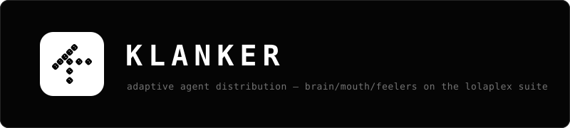
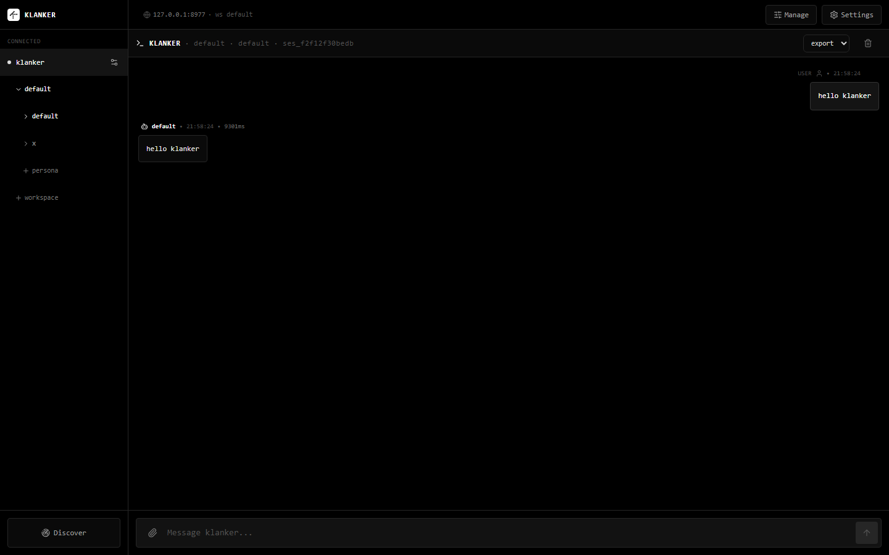
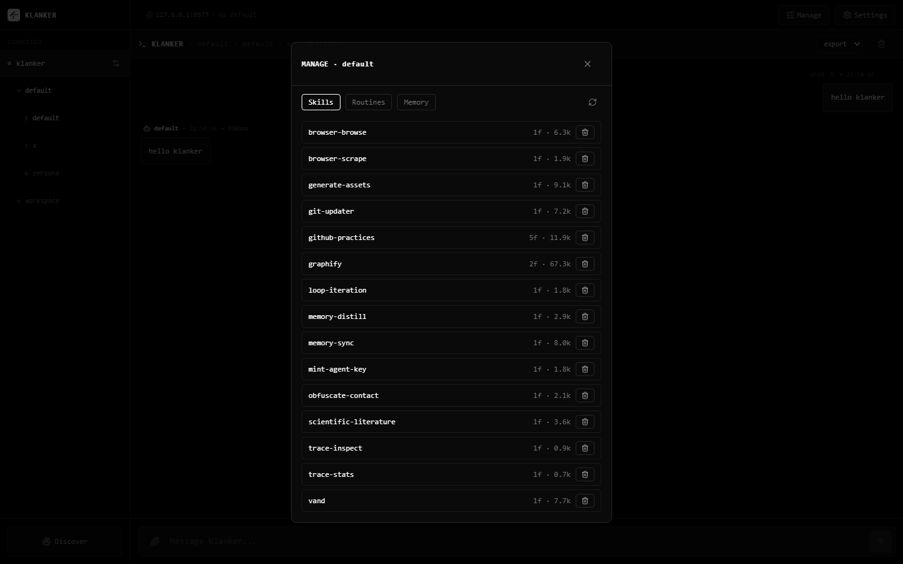
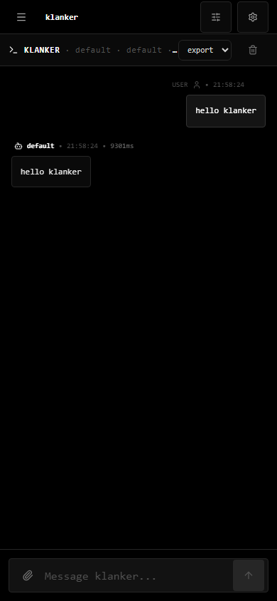

<p align="center">
  
</p>

<p align="center">
  <a href="https://pypi.org/project/klanker/"></a>
  <a href="https://python.org"></a>
  <a href="LICENSE"></a>
</p>

<p align="center">
  Adaptive agent distribution — brain, mouth and feelers on the
  <a href="https://github.com/Lolaplex">Lolaplex</a> suite.<br>
  Terminal companion, background care runner, and self-hosted assistant.
</p>

---

## Quickstart

```bash
pip install klanker            # or: uv tool install klanker

# Interactive shell
klanker
klanker --plain                # stdin/stdout when no TUI

# Probe what this host can do
klanker sense

# One harness turn, non-interactive
klanker chat "ping"
klanker chat "fix the failing test" --workdir <repo>

# Serve HTTP + Telegram + the PWA
klanker serve
# prints a minted URL once, e.g. http://127.0.0.1:8977/?token=<token>
# open it — that is the phone/desktop chat surface
```

`klanker serve` auto-mints a `RELAY_WEB_TOKEN` unless `--no-auth` (or
`RELAY_NO_AUTH=1`) is passed — `--no-auth` also disables the web surface.
A workspace id selects the data boundary:

```bash
klanker --workspace work       # REPL inside data workspace "work"
klanker chat "note this" --workspace work
```

Klanker ships the feelers as dependencies: browser automation
(`agents-browser`), Ed25519 agent keys and DID resolution
(`agents-keys`), calendar (`agents-calendar`), and the workspace sync
line (`agents-workspace`, `agents-store`, `agents-sync`,
`agents-relay`) install with the package. Only the interactive shell
is optional:

```bash
pip install "klanker[repl]"      # interactive shell/TUI
pip install "klanker[all]"       # every optional extension
```

Suite layering (workspace/store/sync/relay/harness/klanker):
[docs/ARCHITECTURE.md](docs/ARCHITECTURE.md).

> [!TIP]
> **🤖 Agent-driven setup:** point your coding agent at this repo and
> tell it to *"install klanker, sense the host, and run my assistant"*.

Dev lock-step, Docker images, NAS self-deploy: [INSTALL.md](INSTALL.md).

## Screenshots

<p align="center">
  
</p>
<p align="center">
  
  
</p>

All captures are the real `klanker serve` dashboard — no mockups. The
Tauri desktop app (`apps/desktop/`) is a thin shell over the same `apps/web/` UI.

## Architecture

```
                 ┌────────────────────────────────────┐
                 │  klanker — CLI, prompt, overlay    │
                 └──┬───────┬──────────┬──────────┬───┘
                    │ REPL  │ serve    │ chat     │ cron
                    ▼       ▼          ▼          ▼
        ┌─────────────┐  ┌──────────────────────────────┐
        │ apps/       │  │ agents-relay — I/O + hub     │
        │ desktop app │  │ /v1/* HTTP, Telegram, PWA,   │
        └─────────────┘  │ channel, pairing, leases     │
                         └───────┬──────────────────┬───┘
                                 ▼                  ▼
                      ┌──────────────────┐  ┌─────────────────┐
                      │ agents-harness   │  │ feelers         │
                      │ loop, tools,     │  │ terminal,       │
                      │ approvals, gate  │  │ memory, traces, │
                      └───────┬──────────┘  │ keys, browser,  │
                              │             │ calendar        │
                              ▼             └─────────────────┘
            ┌──────────────────────┐  ┌────────────────────────┐
            │ agents-sync — opdist │  │ agents-store —         │
            │ op-log envelopes     │  │ store.db datoms, HLC   │
            └──────────┬───────────┘  └───────────┬────────────┘
                       ▼                          ▼
            ┌─────────────────────────────────────────────┐
            │ agents-workspace — host, workspaces, vault  │
            └─────────────────────────────────────────────┘
```

**Layering rule:** `klanker` imports no harness internals. It talks to
the suite through CLIs (`runner.loop`, `agents_relay`,
`agents_terminal`, `agents_memory`, `agents_traces`). The harness owns
the loop, tools and approvals; klanker owns the prompt, the CLI surface
and the overlay. The full workspace/store/sync/relay contract:
[docs/ARCHITECTURE.md](docs/ARCHITECTURE.md).

| Layer | Responsibility | Package |
| :--- | :--- | :--- |
| Workspace | Host/ws split, `workspace.json` policy, secret vault | `agents-workspace` |
| Store | Append-only `store.db` datoms, HLC ordering, `v_current` | `agents-store` |
| Sync | Op-log envelopes, peer cursors, dedupe | `agents-sync` |
| Brain | Deterministic loop, LLM streaming, schedules, session gate | `agents-harness` |
| Memory | Persistent local markdown memory and typed facts | `agents-memory` |
| Observability | Append-only JSONL event log, turn reconstruction | `agents-traces` |
| I/O gateway + hub | `/v1/turn`, `/v1/inject`, hub channel, pairing, leases, `/v1/remote` | `agents-relay` |
| Tools & feelers | Jailed execution, CalDAV, CDP browser, DID keys | `agents-terminal`, `agents-calendar`, `agents-browser`, `agents-keys` |
| Surfaces | PWA chat console; Tauri thin-shell desktop app | `apps/web/`, `apps/desktop/` |

## Feature matrix

| Capability | Surface | Status |
| :--- | :--- | :--- |
| Interactive REPL / one-shot turns | `klanker`, `klanker chat` | landed |
| Host capability probe | `klanker sense [--json]` | landed |
| Dynamic system prompt | `klanker prompt` | landed |
| HTTP + Telegram + PWA gateway | `klanker serve` | landed |
| Scheduled care flows, reminders, routines | `klanker cron`, `remind`, `routine` | landed |
| Multi-workspace, per-persona sessions | `--workspace`, `/v1/workspaces` | landed |
| PWA: streaming chat, workspace tree, export MD/JSON | `apps/web/` on `klanker serve` | landed |
| Management UI: skills, routines, memory | `apps/web/` Manage panel | landed |
| Approval gate (`ask`/`strict`) | harness + relay channel | landed |
| Auto-recall memory + repo per turn | `recall.enabled` / `AGENTS_RECALL`, Settings toggle (`/v1/klanker/recall`) | landed |
| Self-equipping feelers | on demand via `mcp.terminal` | landed |
| Windows desktop app + tray | `apps/desktop/` thin shell over `apps/web/` | in progress |
| Cross-device live turn streaming | `GET /v1/runs/stream` fan-out | landed |
| Workspace op-log sync | `SyncRuntime` (`wssync`) over relay channel | landed |
| Pair-once / share-per-ws | `workspace invite\|join\|share`, hub `/v1/pair/*` | landed |
| Session host binding + worktrees | `session:host` datom, `klanker/s-<id>` branches | landed |
| Remote turn dispatch + run leases | `remote_dispatch`, `/v1/hub/lease` | landed |
| File domains → store.db | `klanker migrate --to-store` | landed |
| Web push (VAPID) | `/v1/push/vapid-key`, `/v1/push/subscribe` | endpoints + client landed; send path pending |

## Commands

| Command | Description |
| :--- | :--- |
| `klanker` | Interactive multi-turn shell |
| `klanker --workdir <path>` | REPL with `AGENTS_WORKDIR` set, workdir locked |
| `klanker sense [--json]` | Probe host, agent packages, MCP servers, skills |
| `klanker prompt [--workspace <id>]` | Print the generated system prompt |
| `klanker chat "msg" [--workspace <id>] [--workdir <path>]` | One harness turn |
| `klanker serve [--no-telegram] [--no-auth]` | HTTP `/v1/*`, PWA at `/`, Telegram, schedule ticker |
| `klanker cron [--flow <name>]` | Scheduled care flows via harness executor |
| `klanker remind add --user <u> --channel <c> --at <when> --text <msg>` | Fixed-text reminder |
| `klanker routine add\|say\|list\|pause\|resume\|remove\|run` | LLM routines (`prompt` + `at`/`cron`) |
| `klanker evidence --from <day> --to <day>` | Per-day routine runs and workspace files |
| `klanker workspace create\|list` | Manage workspaces on this host |
| `klanker workspace share\|unshare\|members` | Grant/revoke paired-device access; show policy + member set |
| `klanker workspace invite\|join` | Mint a ws-scoped pair code/QR on the hub / redeem one |
| `klanker migrate --to-store [--archive]` | Fold personas/config/memory into `<ws>/store.db` |
| `klanker persona list\|add\|inbox\|task\|handoff` | Persona registry + inbox handoffs |
| `klanker import` | Import `~/.claude`, `~/.codex`, `~/.cursor` rules/skills/mcp into a workspace |
| `klanker bg` + `ps`/`logs`/`kill` | Detached background turns |
| `klanker doctor` | Config, keys, MCP health, tokens, suite versions |
| `klanker update` | Update suite packages (git checkouts pull, installs upgrade) |
| `klanker audit` | Trace integrity + replay verification via agents-traces |
| `klanker stop` | Stop the local daemon |

## Workspaces

A host (`AGENTS_HOST_DIR`, default `~/.agents`) holds shared
infrastructure. A workspace (`<host>/workspaces/<id>`) is one data
boundary: memory, rules, skills, modules, schedules, traces, routine
runs, relay state, personas, config.

| Variable | Default | Meaning |
|---|---|---|
| `AGENTS_HOST_DIR` | `~/.agents` | Host root (keys, agents.json, workspaces/) |
| `AGENTS_WORKSPACE` | `default` | Workspace id (not a path) |
| `AGENTS_WORKDIR` | `<ws>/work` | Session working directory (the coding cwd) |

`klanker serve` hosts every workspace on the host; a `/v1/turn` body
picks one with `"workspace": "<id>"`. `GET /v1/workspaces` lists,
`POST /v1/workspaces` creates. `AGENTS_HOME` remains a legacy alias;
a directory passed to `--workspace` maps to `--workdir` with a
deprecation warning for one release.

## Schedules, reminders, routines

`klanker serve` ticks `runner.schedule.tick()` every 60 s
(`KLANKER_TICK=0` disables). A same-minute duplicate is dropped;
replies that are `NO_UPDATE` are not sent. Routine turns inherit a
timeout sized so a turn waiting on an approval is not killed first
(`AGENTS_APPROVAL_TIMEOUT`-aware).

Each finished run — including `NO_UPDATE` and failures — lands under
`<ws>/routine-runs/<name>/` (`index.jsonl` + one markdown file, atomic
writes, pruned past 90 days / newest 2000). `klanker evidence` lists
runs and workspace files per day.

```bash
klanker remind add --user 123456 --channel telegram --at +10m --text "stand up"
klanker routine say "Anything new?" --name morning --user 123456 --cron "0 8 * * *"
klanker routine pause morning && klanker routine run morning
```

External schedulers: remove external `runner.schedule tick` cron jobs —
`serve` already ticks, and double-flocking `.tick.lock` deadlocks.

## PWA, approvals, MCP

- **PWA:** `klanker serve` serves `apps/web/` at `/` behind the minted
  `?token=` URL. `RELAY_WEB_USER` (default `web`) namespaces web
  sessions; set `RELAY_SECRET` if header-authed CLI clients remain.
- **Approvals:** unset `AGENTS_APPROVAL_MODE` runs mutating tools
  ungated. Set `ask` or `strict`; serve fills the default
  `agents-relay approve` command when `AGENTS_APPROVAL_CMD` is unset.
- **Telegram allowlist:** with `TELEGRAM_BOT_TOKEN` set and
  `TELEGRAM_ALLOWED_CHAT_IDS` empty the bot refuses to start;
  `KLANKER_TELEGRAM_OPEN=1` opts into an open bot.
- **MCP & skills:** external servers use Claude/Cursor-shaped
  `<host>/mcp.json` (see `examples/mcp.json`); skills live in
  `<ws>/skills/*/SKILL.md`. `klanker sense` lists and health-checks
  both.

## Docker

The image installs `agents-workspace`, `agents-harness[mcp]`,
`agents-relay`, `agents-memory`, `agents-traces`, `agents-calendar` and
`agents-browser` (no bundled Chromium — set `AGENTS_BROWSER_BIN`).
Packages come from git `main` by default; pin `SUITE_REF` (or
`HARNESS_REF` etc.) for another branch/tag and rebuild `--no-cache`.
`AGENTS_VISION=1` forwards image attachments as vision parts.
Full compose and NAS paths: [INSTALL.md](INSTALL.md).

## Development

```bash
bash hooks/install.sh    # commit discipline — once per clone, never --no-verify
pytest                   # python suite
cd web && npm test       # web unit tests
```

Commits carry `## World Model`, `## Gates`, `## Membrane` sections —
see [AGENTS.md](AGENTS.md). `docs/ROADMAP.md` is the direction doc.

## License

MIT. See [LICENSE](LICENSE).
