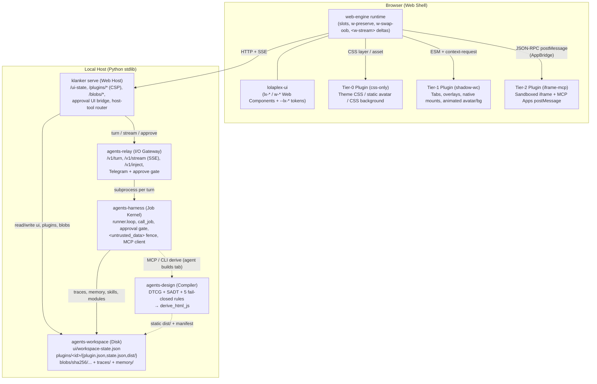

# Klanker Plugin Architecture — Design Doc (Rev 4)

**Status:** Rev 4 — §13's nine sample gaps are `DECIDED (2026-11-27)`; the original eight decisions stay `DECIDED`  
**Date:** 2026-11-27  
**References:** [`klanker-ui-evolution.md`](klanker-ui-evolution.md), [`../research/klanker-ui-review.md`](../research/klanker-ui-review.md), [`../research/klanker-ui-review-addendum.md`](../research/klanker-ui-review-addendum.md). Rev 2 and Rev 3 were not published as separate files; their deltas are the changelog below. External tree: [`Cypoe/koru-orisha-media`](https://github.com/Cypoe/koru-orisha-media) @ `f52bf2b2769a257c399c702484f316939aeb0464`.

### What Changed in Rev 4
- Marked the nine §13 gaps **`DECIDED (2026-11-27)`** from Fabian's answers (t263u). The eight decisions in §9 are unchanged.
- **Media:** host-owned capture with per-workspace approval. Web gets the microphone and routes audio through `agents-voice` / `agents-relay` to provider endpoints (no local models). Desktop runs local engines with downloadable weights.
- **Maps:** no default API key; attribution stays in the manifest; prefer keyless and offline tile sources.
- **Flashcards:** SM-2 first behind a scheduler enum; Anki-like review; reminders are declared triggers; a later scheduler value may use an RWKV scheduler.
- **Calendar:** the plugin is a view over `agents-store`. `text/calendar` is import/export only. [`Lolaplex/agents-calendar`](https://github.com/Lolaplex/agents-calendar) is the existing calendar package.
- **Verbs:** a plugin may declare a new verb. The registry dedupes identical declarations, rejects collisions, and fails loud.
- **Voice fallback** is the explicit disjunction already sketched in §10.5.
- **Triggers** are declared external events that wake a schedule or workflow (inference optional), at-least-once and workspace-local. This matches Lars' WMFX 6-digit-world model (name only; not a schema token).
- **Ambiguity** opens a picker. Universal file/internet URLs (Lolaplex/goblin style) are a future direction, not this scope.
- **Weights** are instance-global. The capability binding may be per workspace. Blobs and Modelfiles are not replicated across instances.
- Neutral naming unchanged: product names stay in prose. They do not appear in functions, capabilities, verbs, or schemas.

### What Changed in Rev 3
- Added **§10 Central Capability Registry & Resolver**, modelled on the host capability register + semantic graph + resolver already shipped in [`Cypoe/koru-orisha-media`](https://github.com/Cypoe/koru-orisha-media) (found there; `Lolaplex/koru-orisha-media` was not accessible to Cursor's GitHub App).
- Plugins declare **provides** / **needs** in `plugin.json` for file extension/MIME handlers, viewers/editors, explorers/browsers, speech/voice capabilities, and triggers/events.
- Added worked examples: opening a `.md` file; speaking a reply with `speech.synthesize`; a `voice.duplex` session replacing a `speech.synthesize` + `speech.recognize` pair.
- Added **§11 Sample plugin: meeting recorder** (clean-room, modelled on AnythingLLM Desktop Meeting Assistant docs + public STT/TTS surfaces; Desktop engine source is **not** in the public MIT repo — marked uncertain).
- Added **§12 Compact samples** for Felix's calendar, world map, flashcards + study helper, and habit tracker (tier, contributions, capability resolution, workspace state, permissive OSS references).
- Added **§13 New Open Decisions** (separate from the 8 decided ones) for gaps revealed by the samples.
- Neutral naming rule unchanged: no product names in functions, capabilities, verbs, or schemas.

### What Changed in Rev 2
- Made **plugin kinds & 7 explicit contribution points** first-class (`theme`, `background`, `avatar`, `overlay`, `tab`, `sidebarItem`, `nativeMount`).
- Elevated **minimal zero-JS plugins** (`tier: "css-only"` for pure CSS themes, static avatars, ambient CSS backgrounds) alongside `shadow-wc` and `iframe-mcp`.
- Added **custom icon/image registration** + **Obsidian-style free sidebar ribbon reordering** persisted in `WorkspaceUIState`.
- Added **§8 Generative UI Landscape** (`thesysdev/openui`, `Aaryan-Kapoor/it`, Google **A2UI v1.0**) and how it maps to `agents-design` + Klanker plugins.
- **Added neutral-naming rule:** functions, capabilities, API methods, manifest schemas, CSS layers, custom element tags, and protocol verbs use neutral, descriptive names with zero product prefixes (`jobs.call:<verb>`, `workspace.state.rw`, `turn.submit`, `stream.subscribe`, `plugin/v1`, `ui-state/v2`, `host/*`). Product names appear only in prose describing components.
- **Marked all 8 Decisions (§9) `DECIDED (2026-11-27)`** as approved by Fabian.

---

## 1. Goals and Non-Goals

### Goals
1. **"Everything is a plugin":** Built-in surfaces (Chat, Traces, Memory, Schedules, Docs), tiny cosmetic tweaks (themes, backgrounds, avatars), floating windows (e.g. a quick-prompt `'dumbo'` or animated avatar overlay), and full persistent user/agent apps all mount through the same manifest, slot, and persistence contract.
2. **Minimal plugins are first-class:** A pure CSS theme override or static avatar needs **zero JavaScript** (`tier: "css-only"`); a tab or floating overlay needs zero bundler.
3. **Per-workspace persistence:** Open tabs, sidebar ribbon order, floating overlay positions, split layout, active conversation/branch, and every plugin's own state persist under `agents-workspace` and survive reload/restart cleanly.
4. **Zero-build agent-generated UI:** Klanker can author a `design.json` IR, validate it through `agents-design`'s 5 fail-closed checker rules, derive static `html/css/js` into `<workspace>/plugins/<id>/dist/`, and hot-mount it without Node, Vite, or restarting the host.
5. **No React in the shell or plugin API:** Host shell runs on `web-engine` + `lolaplex-ui` Web Components. Plugin contracts use browser standards (CSS layers, Custom Elements, Shadow DOM, CSS custom properties, WCCG `context-request`, `iframe` + `postMessage` JSON-RPC).
6. **Neutral, product-free APIs & protocols:** All functions, capabilities, API methods, manifest schemas, CSS layers, element tags, and protocol verbs use neutral descriptive names (e.g. `jobs.call:<verb>`, `workspace.state.rw`, `turn.submit`, `stream.subscribe`, `host/state/get`). Product names appear only in prose describing components.
7. **Reversible lifecycles & strict capabilities:** Unloading a plugin cleanly unwinds every stylesheet, DOM mount, overlay, icon, command, listener, and in-flight call (reversible-effect discipline). Privileged actions always cross the job kernel (`agents-harness`) and `AGENTS_APPROVAL_MODE`.
8. **Lossless, reconnect-safe streaming:** `<w-stream>` / `/v1/stream` supports POST-SSE, opening baselines, typed deltas coalesced per animation frame, root-replace fallback on gap/overflow, `agent_settled`, and SHA-256 blob spilling.

### Non-Goals
- **No React/Svelte runtime in the host shell** (third-party plugins may still bundle React *inside* a Tier-2 sandboxed iframe).
- **No dynamic Node/npm bundler inside Klanker** to install or hot-reload plugins (JupyterLab's prebuilt-only lesson).
- **No in-process arbitrary backend execution** for untrusted UI plugins.
- **No custom canvas text editors** (keep native DOM `<input>`/`<textarea>` for IME and accessibility).
- **No breaking changes to `agents-relay`'s strict I/O boundary** (`agents-relay` never writes under `~/.agents` or owns domain state).

---

## 2. Components and Boundaries

| Component | Repo | Owns | Must NOT Own |
| --- | --- | --- | --- |
| **`klanker`** | `Lolaplex/klanker` | Top-level companion & web host (`klanker serve`), workspace switching, plugin registry HTTP routes (`/v1/workspaces/:ws/plugins/*`, `/ui-state`, `/blobs/*`), static shell + CSP headers, HTML-form approval bridge, schedule ticker | LLM provider HTTP loops, raw CLI verb execution, design-token compilation |
| **`agents-harness`** | `Lolaplex/agents-harness` | Per-turn `runner.loop`, Cordis job kernel (`runner.kernel`, `runner/modules/*.json`), `list_catalog`/`load_schema`/`call_job`, `AGENTS_APPROVAL_MODE` (`ask`/`strict`), `<untrusted_data>` tool fence, external MCP client (`mcp.<server>.<tool>`) | Browser DOM, HTTP routing, UI layout state |
| **`agents-workspace`** | `Lolaplex/agents-workspace` | Canonical workspace root & registry (`Workspace.resolve/list_all/create`), path resolution for all domains including `ui/`, `plugins/`, and `blobs/` | Daemon processes, HTTP servers, UI state semantics |
| **`agents-relay`** | `Lolaplex/agents-relay` | Pure stdlib I/O gateway: `/v1/turn`, `/v1/inject`, `/v1/stream` (POST-SSE), Telegram gateway, `agents-relay approve` decision files in `AGENTS_RELAY_STATE` | Writes under workspace root (`~/.agents`), identity/trace/plugin storage |
| **`web-engine`** | `Lolaplex/web-engine` | Zero-dep browser runtime (`w-*` directives, `w-get`, `w-swap-oob`, `w-preserve`, `<w-stream>` POST-SSE + baseline/delta engine, `ReactiveScope`) + Python stdlib SSG for docs | Business/job logic, framework-specific React/Svelte glue |
| **`lolaplex-ui`** | `Lolaplex/lolaplex-ui` | Design tokens (`--lx-*`), accessible Web Components (`lx-*` + `w-*`, using Zag.js machines internally where appropriate, prebuilt once) | App state, workspace routing, harness RPC |
| **`agents-design`** | `Lolaplex/agents-design` | W3C DTCG tokens, SADT box IR, 5 fail-closed checker rules, deterministic `derive_html_js`, `AcceptanceHook` seam for agent-generated plugins | Runtime state, plugin hosting, external stores |



---

## 3. Plugin Kinds, Contribution Points, and `plugin.json`

### Neutral Naming Rule
All manifest schemas, capabilities, CSS layers, custom element tags, JS host-bridge methods, and JSON-RPC protocol verbs **must use neutral, descriptive names without product prefixes** (no `cordis.*`, `klanker.*`, `dsh.*`, `omp.*`, etc.). Product names appear only in prose describing repository components.

### Explicit Contribution Points

A plugin declares one or more contribution points in `plugin.json`. A plugin can be as small as a single CSS file (`theme`) or combine several surfaces (e.g., a `tab` + a `sidebarItem` + a `chat.node` renderer).

| Contribution Point | Shell Slot | Slot Cardinality | Typical Use Case | Allowed Tiers |
| --- | --- | --- | --- | --- |
| **`theme`** | `shell.theme` | `single` (active theme) or stacked CSS `@layer app-theme` | Pure CSS token override, typography/radius skin | `css-only` |
| **`background`** | `shell.background` | `single` | Ambient canvas/CSS animation behind shell (`pointer-events: none`, respects `prefers-reduced-motion`, pauses when document hidden) | `css-only`, `shadow-wc`, `iframe-mcp` |
| **`avatar`** | `shell.avatar` | `keyed` (`agent` \| `user` \| `assistant:<id>`) | Static image/SVG or animated reactive avatar (speaking/thinking/idle states) | `css-only`, `shadow-wc` |
| **`overlay`** | `shell.overlays` | `list` (layered floating windows) | Floating quick-prompt (`'dumbo'`), animated avatar companion overlay, floating scratchpad; draggable/pinnable with bounds persisted | `shadow-wc`, `iframe-mcp` |
| **`tab`** | `workspace.tabs` + `workspace.activeView` | `list` (strip) + `single` (body) | Full persistent workspace app/view (Orders, Kanban, Whiteboard, Traces) | `shadow-wc`, `iframe-mcp` |
| **`sidebarItem`** | `sidebar.ribbon` | `list` (Obsidian-style reorderable) | **Default entry point** for plugins with a tab/panel/overlay, or standalone action button; accepts custom symbol, SVG, or local image | `css-only` (action-free link), `shadow-wc`, `iframe-mcp` |
| **`nativeMount`** | Declared host slots (`chat.node`, `composer.actions`, `header.actions`, `sidebar.panel.sections`, `artifact.viewer`, `status.bar`) | `list` or `keyed` | Inline widgets mounted directly inside the main interface (custom chat cards, toolbar buttons, inspector sections) | `shadow-wc`, `iframe-mcp` |

**Sidebar Icon & Free Rearrangement (Obsidian Ribbon Rule):**
- Any plugin contributing a `tab`, `overlay`, or `sidebarItem` gets a **sidebar ribbon icon by default** unless it sets `"sidebarDefault": false`.
- Custom icons accept `{ "kind": "symbol" | "svg" | "image", "value": "..." }` (e.g. a design-system icon name, an inline sanitized SVG file `./assets/icon.svg`, or a raster `./assets/icon.png` served from the plugin's own `dist/`).
- Users can **drag-reorder, pin, or hide** any sidebar icon freely; placement is stored in `WorkspaceUIState.sidebar.ribbonOrder` and `WorkspaceUIState.sidebar.hiddenIds` (new plugins append to the end unless pinned).

### Core `plugin.json` Fields

| Field | Type | Required | Meaning |
| --- | --- | --- | --- |
| `schema` | `"plugin/v1"` | Yes | Manifest schema version |
| `id`, `name`, `version` | dotted identifier, string, semver | Yes | Stable ID (e.g. `builtin.chat`, `ws.dumbo-prompt`, `ext.board`), display title, version |
| `tier` | `"css-only"` \| `"shadow-wc"` \| `"iframe-mcp"` | Yes | Isolation tier (Tier 0 / 1 / 2) |
| `entry` | relative path or `ui://` URI | Yes | `.css` / image (`css-only`), ESM module (`shadow-wc`), or HTML / MCP `ui://` (`iframe-mcp`) |
| `element` | custom-element tag | If `shadow-wc` | Hyphenated tag name (e.g. `ui-overlay-dumbo`) |
| `icon` | `{ kind, value }` | No | Custom sidebar/tab icon (`symbol` \| `svg` \| `image`) |
| `contributions` | object | Yes | Explicit map of `theme`, `background`, `avatar`, `overlays`, `tabs`, `sidebarItems`, `nativeMounts`, `commands`, `hostTools` |
| `capabilities` | string[] | Yes | Explicit neutral allowlist (default deny; `[]` for `css-only`): `workspace.state.rw`, `turn.submit`, `stream.subscribe:<topic>`, `jobs.call:<verb>`, `blob.read`, `blob.write`, `host.tools.register` |
| `state` | `{ persist, maxBytes?, schemaVersion? }` | No | Per-plugin persistence declaration |
| `configSchema` | JSON Schema | No | Typed user settings ("Valves" pattern, rendered/validated by host) |
| `csp` | `{ connectSrc?, imgSrc? }` | If `iframe-mcp` | Optional extra CSP domains (default `'none'`, requires approval) |
| `provenance` | `{ source, irSha256?, bundleSha256? }` | No | `"builtin"` \| `"compiled-ir"` \| `"mcp"` \| `"local"` |

### Manifest Examples (All Three Tiers)

**Example 0 — Tier 0 (`css-only`, Zero-JS Theme + Static Avatar + CSS Background):**

```json
{
  "schema": "plugin/v1",
  "id": "ws.midnight-paper",
  "name": "Midnight Paper Theme",
  "version": "1.0.0",
  "tier": "css-only",
  "entry": "./dist/theme.css",
  "icon": { "kind": "image", "value": "./dist/swatch.png" },
  "contributions": {
    "theme": { "stylesheet": "./dist/theme.css", "colorScheme": "dark" },
    "background": { "stylesheet": "./dist/bg.css", "respectReducedMotion": true },
    "avatar": { "target": "agent", "image": "./dist/agent-avatar.svg" }
  },
  "capabilities": []
}
```

**Example 1 — Tier 1 (`shadow-wc`, Floating Prompt `'dumbo'` + Sidebar Toggle + Native Mount):**

```json
{
  "schema": "plugin/v1",
  "id": "ws.dumbo-prompt",
  "name": "Dumbo Floating Prompt",
  "version": "0.1.0",
  "tier": "shadow-wc",
  "entry": "./dist/index.js",
  "element": "ui-overlay-dumbo",
  "icon": { "kind": "svg", "value": "./dist/dumbo-icon.svg" },
  "contributions": {
    "sidebarItems": [{ "id": "dumbo-toggle", "tooltip": "Toggle Dumbo Prompt", "action": "overlay:dumbo" }],
    "overlays": [{ "id": "dumbo", "title": "Dumbo", "draggable": true, "resizable": false, "defaultAnchor": "bottom-right", "shortcut": "Mod+Shift+Space" }],
    "nativeMounts": [{ "slot": "composer.actions", "id": "dumbo-pin" }],
    "hostTools": [{ "name": "dumbo_get_draft", "description": "Read current floating prompt draft", "readOnly": true }]
  },
  "capabilities": ["workspace.state.rw", "turn.submit", "stream.subscribe:turn", "host.tools.register"],
  "state": { "persist": true, "maxBytes": 32768, "schemaVersion": 1 },
  "provenance": { "source": "compiled-ir", "irSha256": "e3b0c442..." }
}
```

**Example 2 — Tier 2 (`iframe-mcp`, Third-Party / MCP App Tab + Inline Chat Card):**

```json
{
  "schema": "plugin/v1",
  "id": "ext.excalidraw-board",
  "name": "Whiteboard",
  "version": "1.2.0",
  "tier": "iframe-mcp",
  "entry": "ui://excalidraw/board.html",
  "icon": { "kind": "symbol", "value": "pen-tool" },
  "contributions": {
    "tabs": [{ "id": "whiteboard", "title": "Whiteboard", "retainWhenHidden": false }],
    "nativeMounts": [{ "slot": "chat.node", "key": "diagram.v1" }]
  },
  "capabilities": ["workspace.state.rw", "jobs.call:mcp.excalidraw.export_svg", "blob.read"],
  "state": { "persist": true, "maxBytes": 262144, "schemaVersion": 1 },
  "csp": { "connectSrc": [], "imgSrc": ["data:", "blob:"] },
  "provenance": { "source": "mcp", "bundleSha256": "9f86d081..." }
}
```

---

## 4. Plugin Lifecycle & Reversible Teardown

Every mounted plugin receives an isolated `PluginScope` (`AbortController` + disposer stack). **Every registration returns a disposer owned by that scope** (reversible-effect discipline): CSS `<link>`/adopted stylesheets, background/avatar layers, floating overlays, sidebar ribbon entries, tabs, native slot mounts, commands, SSE subscriptions, `hostTools`, and in-flight RPCs.

1. **Install:** Human or agent writes `plugin.json` + static `dist/` into `<workspace>/plugins/<id>/` via a job verb. Host validates schema, verifies `irSha256` + runs `agents-design check` fail-closed for `compiled-ir` plugins, and prompts approval (`AGENTS_APPROVAL_MODE`) for any capability beyond `css-only`.
2. **Load & Hot-Mount (Zero Rebuild):** `klanker serve` emits `{ type: "plugin.installed", id, manifest }` on the workspace SSE stream. Shell creates a `PluginScope` and attaches contributions by tier:
   - **Tier 0 (`css-only`):** Injects a scoped `<link>` in `@layer app-theme` / binds background CSS or avatar `src`. Zero JS execution.
   - **Tier 1 (`shadow-wc`):** Native ESM `import("/plugins/<id>/dist/index.js?v=<rev>")`, creates `<element>`, calls `setConfig(config)` + `setInitialState(state)`, wires WCCG `context-request`.
   - **Tier 2 (`iframe-mcp`):** Mounts `<iframe sandbox="allow-scripts" src="/plugins/<id>/dist/index.html">` (or MCP `ui://` proxy URL) and runs the `AppBridge` `ui/initialize` handshake.
3. **Hide / Park vs. Suspend:**
   - Default (`retainWhenHidden: false`, VS Code recommendation): hidden tab/overlay flushes `setState(strip(state))` and unmounts its DOM/iframe, resurrecting cleanly on re-open.
   - Opt-in (`retainWhenHidden: true`, capped e.g. max 3 hidden surfaces): parks DOM with `[hidden]` + `w-preserve` so live terminals/canvases survive tab switches.
4. **Update (Hot Swap):** Flush `setState()` → `scope.dispose()` old revision → load `?v=<new-sha256>` → restore persisted `state` (running `schemaVersion` migration if needed).
5. **Unload / Remove:** `scope.dispose()` atomically removes stylesheets, overlays, sidebar icons, tabs, native mounts, commands, `hostTools`, and aborts all in-flight calls; closing an active tab activates MRU unfinished tab (Synara rule). `remove` deletes `<workspace>/plugins/<id>/` (optionally archiving `state.json`).

---

## 5. State Model (Two Piles + Deltas + Blob Spilling)

### Workspace Directory Additions (`agents-workspace`)

```text
<workspace_root>/
├── workspace.json
├── memory/  traces/  schedules/  modules/  skills/  relay/
├── ui/
│   └── workspace-state.json      # stripped WorkspaceUIState (atomic temp-file + rename)
├── plugins/
│   └── <plugin-id>/
│       ├── plugin.json           # manifest + approved capability grant hash
│       ├── state.json            # persisted plugin JSON state (or row in store.db)
│       ├── design.json           # optional agents-design IR source
│       └── dist/                 # static html/css/js/svg/png assets
└── blobs/
    └── sha256/<hh>/<hh>/<64-hex> # content-addressed spilled tool/artifact outputs
```

### Two Piles `WorkspaceUIState` and `strip(state)`

All durable shell chrome state lives in one serializable JSON object owned by the `web-engine` shell:

```json
{
  "schema": "ui-state/v2",
  "revision": 42,
  "activeThemeId": "ws.midnight-paper",
  "activeBackgroundId": "ws.midnight-paper",
  "activeTabId": "tab-chat-main",
  "sidebar": {
    "collapsed": false,
    "ribbonOrder": ["builtin.chat", "ws.dumbo-prompt", "ext.excalidraw-board", "builtin.traces"],
    "hiddenIds": []
  },
  "tabs": [
    { "tabId": "tab-chat-main", "pluginId": "builtin.chat", "title": "Chat", "params": { "sessionId": "ses_01" }, "pinned": true }
  ],
  "overlays": {
    "ws.dumbo-prompt:dumbo": { "open": true, "minimized": false, "pinned": true, "x": 920, "y": 640 }
  },
  "sidePanel": { "open": true, "pluginId": "builtin.traces", "widthPx": 380 },
  "chat": { "activeBranchBySession": { "ses_01": "msg_19" }, "draftBySession": { "ses_01": "" } }
}
```

- **Explicit `strip(state)`:** Strips ephemeral fields (`hoverId`, `draggingIconId`, `draggingOverlay`, `connectionPhase`, live streaming buffers, native input focus/caret) before debounced `PUT /v1/workspaces/:ws/ui-state`.
- **Per-plugin `state.json`:** Isolated per plugin via `host.setState(strip(local))` → `PUT /v1/workspaces/:ws/plugins/<id>/state` (bounded by `state.maxBytes`, atomic write).

### Typed Deltas, Reconnect Baselines, and Blob Spilling
- **Opening baseline:** Every `<w-stream>` / `/v1/stream` connection opens with `{ type: "baseline", generation, seq, cursor, items, projections }`; reconnect replaces the retained window atomically.
- **Typed list/stream deltas:** Operations `{ type: "delta", generation, seq, op: "append" | "insert" | "remove" | "patch", id, index, item, patch }` coalesce per `requestAnimationFrame`; any sequence gap, generation mismatch, or pending-ops overflow falls back cleanly to an atomic root `replace()`.
- **Terminal compaction & pagination:** `turn_end` / `agent_end` omit already-streamed items (`messageCount` only), followed by `agent_settled`; older history loads via cursor-paginated `GET /v1/sessions/:id/messages?cursor=<leaf:count>&limit=50`.
- **SHA-256 blob spill:** Tool outputs / artifacts >64 KiB spill to `<workspace>/blobs/sha256/<hh>/<hh>/<hex>` and stream as `{ "$blob": "sha256:<hex>", "bytes": ..., "mime": ..., "preview": "..." }`.
- **CI law (`incremental == recompute`):** Playwright differential tests assert that incremental delta application produces the exact same DOM + `strip(state)` as a fresh render of the final state.

---

## 6. Host <-> Plugin Protocol

- **Tier 0 (`css-only`):** No JS bridge; CSS inherits/overrides design tokens inside `@layer app-theme`.
- **Tier 1 (`shadow-wc`):** WCCG `context-request` event (`bubbles: true, composed: true`) injects a capability-scoped `HostBridge`:
  - `getState()`, `setState(state)`
  - `callJob(verb, params)` (requires `jobs.call:<verb>`)
  - `submitTurn(input)` (requires `turn.submit`)
  - `subscribe(topic, handler)` (requires `stream.subscribe:<topic>`)
  - `registerHostTool(spec, handler)` (requires `host.tools.register`)
  - `onCleanup(disposer)`
  Inherits design-token CSS custom properties across Shadow DOM automatically.
- **Tier 2 (`iframe-mcp`):** JSON-RPC 2.0 over `postMessage` implementing the MCP Apps (`2026-01-26`) subset (`ui/initialize`, `ui/notifications/host-context-changed`, `tools/call` routed through capability check + job kernel + `AGENTS_APPROVAL_MODE`), plus neutral host methods:
  - `host/state/get`, `host/state/set`
  - `host/jobs/call`
  - `host/turn/submit`
  - `host/stream/subscribe`
  - `host/tools/register`
- **Host Tools:** Plugins expose live UI state/actions to `agents-harness` as session tools (`ui.<plugin-id>.<tool>`); results are fenced in `<untrusted_data source="plugin:<id>">`.
- **HTML `<form>` Prompts:** Tool approvals and structured agent questions render as sanitized HTML `<form>` inside `workspace.modal` or inline `chat.node` via `web-engine`, validated server-side before unblocking `agents-relay approve`.

---

## 7. Security Model and Trust Levels

| Trust Level | Isolation Tier | Allowed Sources | Sandbox / Enforcement | Approval Required |
| --- | --- | --- | --- | --- |
| **L0 — Cosmetic / Built-in** | `css-only` or `shadow-wc` | Pure CSS/images, or bundled with `klanker` + `lolaplex-ui` | `css-only`: zero JS, strict MIME + sanitized CSS (`@import` external URLs blocked by CSP). Built-in `shadow-wc`: Shadow DOM + job-kernel gate | None on install; job-kernel gate on mutating verbs |
| **L1 — Workspace Verified (Agent-Generated)** | `shadow-wc` (or `iframe-mcp` if custom JS) | Deterministic `agents-design` output (`provenance.source === "compiled-ir"`, `irSha256` verified, 5 fail-closed rules passed, zero arbitrary inline `<script>`) | Shadow DOM + strict CSP (`script-src 'self'`, no `eval`); `PluginScope` capability allowlist | Explicit user approval on install & any capability escalation |
| **L2 — Untrusted / Third-Party / MCP App** | **`iframe-mcp` (mandatory)** | External MCP `ui://`, community plugins, custom JS/React bundles | `<iframe sandbox="allow-scripts">` (**NEVER `allow-same-origin`** — opaque null origin); CSP `default-src 'none'; script-src 'self'; connect-src 'none'`; all I/O mediated via `postMessage` | Explicit approval on install, every `csp.connectSrc` domain, and mutating `tools/call` / `host/jobs/call` |

**Hard invariants:** fail closed on missing capabilities (`403`); never combine `allow-same-origin` + `allow-scripts`; the job kernel in `agents-harness` is the sole privilege choke point (zero raw secrets/FS/shell in plugins); `<untrusted_data source="plugin:<id>">` fence on all plugin text entering prompts; canonical path-jailing inside `<workspace>/plugins/<id>/`.

---

## 8. Generative UI Landscape & Fit with `agents-design` + Klanker Plugins

Klanker has **two complementary UI generation timescales**: (1) **durable workspace apps/tabs/overlays** compiled once into static plugin bundles by `agents-design`, and (2) **ephemeral turn-time UI cards** streamed inside a chat reply (`chat.node` slot). Three key external references inform how these fit together:

| Project | Repo & License (Verified) | Core Mechanism | Fit with `agents-design` + Klanker |
| --- | --- | --- | --- |
| **OpenUI** (`thesysdev`) | [`thesysdev/openui`](https://github.com/thesysdev/openui) — **MIT** (`LICENSE`) | **OpenUI Lang**: compact streaming-first UI DSL (~52–67% fewer tokens than JSON) parsed progressively by framework-agnostic `@openuidev/lang-core` against a registered component catalog; also ships `@openuidev/a2ui` (A2UI v1.0 client). | **Safe to study/port (MIT).** Useful inspiration if JSON verbosity for turn-time `chat.node` cards becomes a token/latency bottleneck: `agents-design` could expose a compact streaming projection over `lolaplex-ui` primitives while keeping full `design.json` + 5 fail-closed rules for durable plugins. |
| **It** *(formerly Surface)* | [`Aaryan-Kapoor/it`](https://github.com/Aaryan-Kapoor/it) — **Source-available "It License" v1.1** (`LICENSE.md`; **NOT OSI-open** — restricts commercial/hosted/competing use; company use capped at 30-day eval after 2027-01-12; only `addons/skill/` & `docs/` unrestricted) | Local companion where agents generate task-specific interactive pages served to any paired screen (laptop/phone/TV over LAN/Tailscale); **every tap routes back to the owning agent session, waking/resuming it hours later with context.** | **Clean-room inspiration ONLY — do NOT copy code!** Strongly validates Klanker's persistent tab + `turn.submit` + session-bound cold-resume model (a persisted tab button can wake its originating Klanker session via `/v1/turn` long after the chat closed). Multi-screen pairing is a compelling later capability. |
| **Google A2UI v1.0** *(Agent-to-User Interface)* | [`a2ui-project/a2ui`](https://github.com/a2ui-project/a2ui) *(formerly `google/A2UI`)* — **Apache-2.0** (`LICENSE`); [v1.0 Spec](https://a2ui.org/specification/v1.0-a2ui/) released Nov 11, 2026 | Open JSON streaming UI protocol (`agent_to_renderer` / `renderer_to_agent`): 4 core messages (`createSurface`, `updateComponents`, `updateDataModel`, `deleteSurface`) + v1.0 bidirectional typed RPC (`callRendererFunction` / `callAgentFunction`). **v1.0 explicitly forbids `theme`/hardcoded colors** (deferring 100% to host native tokens) and ships a first-party **Lit** Web Components renderer. | **Best standard fit for turn-time ephemeral UI (Apache-2.0).** A2UI v1.0's strict data/structure separation and zero-inline-theme rule mirror `agents-design` Rule 1. Klanker can mount an A2UI renderer as a **native `chat.node` plugin** backed by `lolaplex-ui` components — using **A2UI** for ephemeral inline surfaces and **`agents-design` (`plugin.json`)** for durable, check-verified workspace apps/tabs/overlays. *(Uncertainty: A2UI v1.0 just went stable in Nov 2026; ecosystem catalogs are still settling, so keep any A2UI adapter as an optional plugin rather than baking it into `web-engine` core.)* |

---

## 9. Architectural Decisions — All 8 DECIDED (2026-11-27)

1. **Streaming transport between browser and `klanker` / `agents-relay` — `DECIDED (2026-11-27)`:**  
   **SSE (`POST /v1/stream`) + unary HTTP `POST` commands for v1.** Fits Python stdlib `http.server` in `agents-relay` with zero third-party WebSocket deps, works cleanly with `<w-stream>` and reverse proxies/Coolify, and keeps upgrades to WebSocket possible behind `web-engine`'s transport seam later.
2. **Where `klanker` Web UI host lives — `DECIDED (2026-11-27)`:**  
   **Inside `klanker serve`** (optional `--web` flag / default local listener), delegating turns/streams to `agents-relay` and workspace paths to `agents-workspace`. Avoids another daemon to supervise and keeps `agents-relay` strictly stateless I/O.
3. **Agent-generated plugin tier (`L1`) — `DECIDED (2026-11-27)`:**  
   **Tier-1 `shadow-wc` when strictly derived by `agents-design` (`provenance.source === "compiled-ir"`, zero custom JS, verified `irSha256`), and Tier-2 `iframe-mcp` as soon as an agent writes custom JS.** Clean security boundary: declarative IR gets native speed; arbitrary JS gets iframe isolation.
4. **State storage format for plugin `state.json` — `DECIDED (2026-11-27)`:**  
   **Per-plugin `state.json` (atomic rename) for v1**, with a `StateStore` abstraction so large/high-write plugins can move to `store.db` later without breaking the plugin API.
5. **`klanker-desktop` (Tauri 2 + React 19) convergence — `DECIDED (2026-11-27)`:**  
   **Converge onto the `web-engine` shell inside Tauri**, retiring duplicate React UI code once chat + plugin parity lands.
6. **`agents-workspace` domain registration — `DECIDED (2026-11-27)`:**  
   **Add `plugins`, `ui`, and `blobs` as first-class domains in `Lolaplex/agents-workspace`** (`ws.plugins`, `ws.ui`, `ws.blobs`) so `agents-workspace migrate/info/path`, `agents-harness` blob spilling, and `klanker` share one source of truth.
7. **MCP Apps protocol version & client dependency — `DECIDED (2026-11-27)`:**  
   **Tiny zero-dep (~150 LOC) `AppBridge` subset in `web-engine` / `lolaplex-ui`** covering `ui/initialize`, `ui/notifications/host-context-changed`, `tools/call`, and neutral `host/*` state/turn/stream methods — keeps the shell 100% npm-free while staying wire-compatible with external MCP Apps (`2026-01-26`).
8. **Optional `Lit` + `Zag.js` inside `lolaplex-ui` — `DECIDED (2026-11-27)`:**  
   **Use `@zag-js/*` machines inside prebuilt `lolaplex-ui` widgets** (MIT, zero React, gold-standard ARIA/keyboard) while keeping `web-engine` itself 100% dependency-free.

---

## 10. Central Capability Registry & Resolver

### 10.1 Source of shape (koru-orisha-media)

The registry/resolver below is modelled on the host capability register + semantic graph already shipping in [`Cypoe/koru-orisha-media`](https://github.com/Cypoe/koru-orisha-media) @ `f52bf2b2769a257c399c702484f316939aeb0464` (found under that org; `Lolaplex/koru-orisha-media` was not accessible to Cursor's GitHub App). Product names never appear in capability IDs, verbs, or schemas — only in this prose attribution.

| koru pattern (closed shape / open membership) | Klanker plugin equivalent |
|---|---|
| `HOST_CAPABILITIES` closed set (`play`, `library`, `browse`, `configure`, …) in `scripts/semantic_schema.py` / `src/graph.kz` | Host capability IDs: `file.open:<mime>`, `file.browse`, `speech.synthesize`, `speech.recognize`, `voice.duplex`, `trigger:<event>`, … |
| EntityType / Assertion registries with `register` / `resolve` / `hostHas` | Plugin-declared `provides` / `needs` entries registered at install; host `CapabilityRegistry.resolve(need)` |
| `resolve_asset` → concrete path or structured failure (`ok` / `missing` / `ambiguous` / `forbidden`) | `ResolveResult` = `{ status, providerId?, affordances?, reason? }` — **no dishonest fallback** |
| Mount-level `capability` + `affordances` (e.g. `library_roots`) | Provider entries carry `capability`, `affordances[]`, `rank`, `tier`, `permissions[]` |
| `fileKind` / `playerTag` MIME → viewer dispatch | `file.open:<mime>` → ranked viewer/editor providers |
| Accept-loop `! walk` / `! hydrate` triggers | `triggers[]` with `on` events (`session.start`, `file.opened`, `turn.completed`, …) |
| `KIND_NAV` / `player-*` consumers | Shell slots + contribution points that consume a resolved provider |

### 10.2 Registry model

```
CapabilityRegistry
  ├── hostBuiltins[]          # always present (e.g. text/plain viewer, file.browse)
  ├── providers[]             # one row per plugin provides entry (or host built-in)
  │     id, pluginId?, capability, match?, affordances[],
  │     rank, tier, permissions[], contribution?
  ├── needs[]                 # declared by plugins + shell surfaces at load
  └── overrides{}             # workspace-scoped: capability → providerId
```

**Capability ID grammar (neutral):**

| Kind | Pattern | Examples |
|---|---|---|
| File open / view / edit | `file.open:<mime>` or `file.open:ext:<ext>` | `file.open:text/markdown`, `file.open:ext:md`, `file.open:audio/mpeg` |
| File browse / explore | `file.browse`, `file.explore:<domain>` | `file.browse`, `file.explore:calendar`, `file.explore:map` |
| Speech | `speech.synthesize`, `speech.recognize` | — |
| Voice session | `voice.duplex` | Replaces a synthesize+recognize pair for one session |
| Triggers | `trigger:<event>` | `trigger:session.start`, `trigger:file.opened`, `trigger:turn.completed` |
| Generic | `<domain>.<verb>` | `calendar.view`, `study.review`, `habit.checkin` |

**Provider row (conceptual):**

```json
{
  "id": "plugin.docs-viewer:md",
  "pluginId": "plugin.docs-viewer",
  "capability": "file.open:text/markdown",
  "match": { "mime": ["text/markdown"], "ext": ["md", "markdown"] },
  "affordances": ["view", "edit", "preview"],
  "rank": 100,
  "tier": "shadow-wc",
  "permissions": ["workspace.state.rw"],
  "contribution": "tab"
}
```

**Need row (conceptual):**

```json
{
  "from": "shell.chat",
  "capability": "speech.synthesize",
  "affordances": ["stream"],
  "optional": true
}
```

### 10.3 Resolution algorithm

```
resolve(need, workspace):
  1. candidates = providers where capability matches need.capability
       AND affordances ⊇ need.affordances
       AND tier allowed by workspace policy
       AND permissions approved (or promptable)
  2. if workspace.overrides[need.capability] set:
       pick that provider if still in candidates; else status=forbidden
  3. else sort by (user-pinned > explicit rank desc > tier preference > install order)
  4. if 0 candidates → { status: "missing", reason }
     if tie and no override → { status: "ambiguous", candidates }
     else → { status: "ok", providerId, affordances }
```

Rules carried from koru, plus the verb rule decided in §13.5:
- **Fail closed.** Missing provider is an explicit `missing` result, never a silent substitute that pretends to satisfy the need.
- **No dishonest fallback.** A lower-fidelity provider may only be chosen if it still declares the requested affordances, or if the caller wrote an explicit alternative (the voice disjunction in §13.6).
- **Verb registration fails loud.** Identical declarations dedupe. A colliding declaration aborts install. The resolver does not pick "the other" verb.
- **Overrides are workspace-scoped** and persisted in `ui/workspace-state.json` (`schema: "ui-state/v2"`, §5).

### 10.4 `plugin.json` provides / needs

```json
{
  "id": "plugin.example",
  "tier": "shadow-wc",
  "contributes": [{ "point": "tab", "id": "main", "title": "Example" }],
  "provides": [
    {
      "capability": "file.open:text/markdown",
      "match": { "mime": ["text/markdown"], "ext": ["md"] },
      "affordances": ["view", "edit"],
      "rank": 100
    }
  ],
  "needs": [
    { "capability": "speech.synthesize", "affordances": ["stream"], "optional": true }
  ],
  "triggers": [
    { "on": "file.opened", "match": { "ext": ["md"] }, "action": "open-tab" }
  ],
  "permissions": ["workspace.state.rw"]
}
```

### 10.5 Worked examples

#### A. Open a `.md` file

1. Shell receives `file.open` for `notes/ideas.md` → MIME `text/markdown`.
2. `resolve({ capability: "file.open:text/markdown", affordances: ["view"] })`.
3. Candidates: host built-in plaintext viewer (rank 10, affordance `view` only); `plugin.docs-viewer` (rank 100, `view`+`edit`).
4. Result: `ok` → `plugin.docs-viewer`. Shell mounts its `tab` contribution and passes the blob path via `host/resource/read`.
5. If the user pinned the built-in viewer in workspace overrides, that wins even at lower rank.

#### B. Speak a reply (`speech.synthesize`)

1. Chat surface finishes a turn and needs audible output.
2. `resolve({ capability: "speech.synthesize", affordances: ["stream"] })`.
3. Candidates: `plugin.tts-local` (WASM/ONNX, `stream`), `plugin.tts-cloud` (needs network permission).
4. Rank + permission gate pick `plugin.tts-local`. Chat calls the provider through `host/capability/invoke` (neutral); audio bytes go to the shell speaker device — the plugin never touches raw mic/speaker device nodes directly in `shadow-wc` tier.

#### C. `voice.duplex` replaces synthesize + recognize

1. User starts a hands-free session. Shell needs **both** listen and speak with barge-in.
2. Prefer a single provider: `resolve({ capability: "voice.duplex", affordances: ["barge-in", "stream"] })`.
3. If `ok`, that provider owns the full duplex session (one permission grant: `media.mic` + speaker).
4. If `missing`, the shell falls back only when the need **declares** the disjunction `voice.duplex | (speech.recognize & speech.synthesize)` (§13.6). There is no implicit fallback.
5. Session end emits `trigger:voice.session.end` so transcript plugins can persist.

### 10.6 Ownership, persistence, approval

| Concern | Rule |
|---|---|
| Who owns a capability ID? | The host ships a starter vocabulary. A plugin may **declare a new verb**. An identical declaration (same id and same shape) is deduped to one row. The same id with a different shape is a **collision**: install fails loud and nothing is overridden. |
| Who owns runtime state? | Providing plugin's `state.json`; artifact bytes in the workspace `blobs` domain; capability overrides in `ui/workspace-state.json`. Model weights are instance-global (§13.9), not workspace blobs. |
| Approval | First use of a permission-gated provider prompts once per workspace; decision stored with the override/pin. |
| Conflicts | `ambiguous` opens a picker; picking writes an override. A collision never reaches the resolver. |

---

## 11. Sample Plugin: Meeting Recorder

Clean-room sample modelled on the **AnythingLLM Desktop Meeting Assistant** behaviour described in public docs/announcements (local record → STT → diarization → summary → tasks). **Uncertainty note:** as of research (2026-11-27), the Meeting Assistant engine does **not** appear in the public [`Mintplex-Labs/anything-llm`](https://github.com/Mintplex-Labs/anything-llm) MIT tree (Desktop-only surface; public repo has separate chat STT/TTS). Treat this sample as **docs-inspired**, not a port. Do not copy Desktop binaries or non-public code. Public-repo STT/TTS modules are MIT and may inform API shape only.

### 11.1 Full `plugin.json`

```json
{
  "id": "plugin.meeting-recorder",
  "name": "Meeting Recorder",
  "version": "0.1.0",
  "tier": "iframe-mcp",
  "contributes": [
    { "point": "sidebarItem", "id": "meetings", "title": "Meetings", "icon": "asset:icon.svg", "order": 40 },
    { "point": "tab", "id": "meeting-session", "title": "Meeting", "icon": "asset:icon.svg" },
    { "point": "overlay", "id": "rec-indicator", "title": "Recording", "when": "recording" }
  ],
  "provides": [
    {
      "capability": "file.open:audio/mpeg",
      "match": { "mime": ["audio/mpeg", "audio/wav", "audio/webm"], "ext": ["mp3", "wav", "webm"] },
      "affordances": ["transcribe", "view"],
      "rank": 80
    },
    {
      "capability": "speech.recognize",
      "affordances": ["stream", "diarize"],
      "rank": 90
    },
    {
      "capability": "trigger:meeting.ended",
      "affordances": ["summarize", "extract-tasks"],
      "rank": 100
    }
  ],
  "needs": [
    { "capability": "speech.recognize", "affordances": ["stream"], "optional": false },
    { "capability": "speech.synthesize", "affordances": ["stream"], "optional": true },
    { "capability": "voice.duplex", "affordances": ["barge-in"], "optional": true }
  ],
  "triggers": [
    { "on": "session.start", "action": "arm-hotkey" },
    { "on": "meeting.ended", "action": "summarize-and-persist" }
  ],
  "permissions": [
    "media.mic",
    "media.loopback",
    "workspace.state.rw",
    "workspace.blobs.rw",
    "jobs.call:summarize"
  ],
  "mcp": {
    "tools": ["meeting.start", "meeting.stop", "meeting.list", "meeting.open"],
    "bridge": ["ui/initialize", "tools/call", "host/state/get", "host/state/set", "host/blobs/put"]
  }
}
```

Tier is **`iframe-mcp`** because capture + custom STT/diarization JS is not `agents-design` IR. If a future build is strictly compiled IR with host-owned capture APIs, it could drop to `shadow-wc` under Decision 3.

### 11.2 Capability resolution walkthrough

1. User clicks **Record** in the Meetings tab → plugin requests `media.mic` (+ optional `media.loopback` for system audio). Approval stored per workspace.
2. During capture, plugin prefers `voice.duplex` if available (live captions + optional spoken confirmations); else uses its own `speech.recognize` provider (`provides` self-satisfy when the plugin is both needer and provider).
3. On stop → emit `trigger:meeting.ended`. Resolver finds this plugin's summarize/extract-tasks affordances → runs `jobs.call:summarize` against the workspace agent.
4. Opening an existing `*.webm` from the library → `file.open:audio/webm` resolves here for `transcribe`+`view`.

### 11.3 Persistence layout

Index stays in the plugin's `state.json` (atomic rename — Decision 4). Audio, transcript, summary, and tasks spill through the workspace `blobs` domain (Decision 6 / §5 content-addressed `blobs/sha256/…`), referenced by digest. The plugin does not invent a second blob tree under `plugins/<id>/`.

```
$WORKSPACE/
  plugins/plugin.meeting-recorder/state.json
  blobs/sha256/<hh>/<hh>/<digest>     # audio, transcript, summary, tasks
```

`state.json`:

```json
{
  "version": 1,
  "sessions": [
    {
      "id": "01HZX…",
      "title": "Weekly sync",
      "startedAt": "2026-11-27T12:00:00Z",
      "endedAt": "2026-11-27T12:45:00Z",
      "audio": { "$blob": "sha256:…", "mime": "audio/webm" },
      "transcript": { "$blob": "sha256:…", "mime": "application/json" },
      "summary": { "$blob": "sha256:…", "mime": "text/markdown" },
      "tasks": { "$blob": "sha256:…", "mime": "application/json" }
    }
  ],
  "settings": { "language": "en", "diarize": true }
}
```

### 11.4 License / portability notes

| Source | License / access | Use in this sample |
|---|---|---|
| Public anything-llm repo (chat STT/TTS, etc.) | MIT | Inspiration for tool/API shape only |
| Desktop Meeting Assistant engine | **Not in public tree** (unconfirmed / Desktop-only) | **Do not copy**; clean-room from public docs |
| Models cited in public announcements (e.g. Parakeet-class STT, Nemotron-class summarizers) | Separate model licenses | Downloadable weights, not shipped in the image. Instance-global cache (§13.9) |

### 11.5 Where the audio goes

Capture stays host-owned (`media.mic`, optional `media.loopback` on desktop) with one approval per workspace (§13.1).

| Surface | Models | Path |
|---|---|---|
| Web | None on the client | Microphone audio goes through `agents-voice` / `agents-relay` to a provider endpoint |
| Desktop | Local, downloaded on demand | Wake-word, final transcription, and speech synthesis run on the instance. Weights are not copied per workspace |

The settings surface for choosing a provider or a downloaded pack may follow the layout of AnythingLLM's settings page. The rest of that product's interface is not a reference.

---

## 12. Compact Samples (Felix)

Four compact plugin sketches. Each lists tier, contribution points, capability resolution, workspace state, and 1–2 **permissive** OSS references (license noted). Product names appear only as references — never inside capability IDs or schemas.

### 12.1 Calendar — `plugin.calendar`

The plugin is a **view over `agents-store` data**. It does not own a second event database. [`Lolaplex/agents-calendar`](https://github.com/Lolaplex/agents-calendar) (MIT; public package is the CalDAV feeler) is the existing calendar package, and Fabian describes it as essentially the `agents-store` proof of concept rendered as a projection. `text/calendar` (ICS) is **import/export interchange only**.

| Field | Value |
|---|---|
| **Tier** | `shadow-wc` when the view is `agents-design` IR over store rows |
| **Contributes** | `sidebarItem` (Calendar), `tab` (Month/Week), optional `overlay` (quick-add) |
| **Provides** | `file.explore:calendar`; `file.open:text/calendar` with affordances `import` and `export` only; `trigger:calendar.event.due` |
| **Needs** | read/write of the store projection the host exposes; optional `speech.synthesize` for spoken reminders |
| **Resolution** | Agenda surfaces resolve `file.explore:calendar` to this view. An `.ics` open runs import or export. It does not become the system of record |
| **State** | `state.json` holds view chrome only: `{ visibleIds[], timezone, weekStart }`. Events live in `agents-store` |
| **OSS refs** | [FullCalendar](https://fullcalendar.io/) **Standard** bundle (**MIT**) for the month/week view; [ical.js](https://github.com/kewisch/ical.js) (**MPL-2.0**) only for the import/export edge |

### 12.2 World map — `plugin.world-map`

| Field | Value |
|---|---|
| **Tier** | `iframe-mcp` (map engine + tile fetch is custom JS / network) |
| **Contributes** | `sidebarItem` (Map), `tab` (Map view), optional `nativeMount` for large canvas |
| **Provides** | `file.open:application/geo+json` (`view`); `file.explore:map`; `trigger:map.selection` |
| **Needs** | network permission for tiles; optional geolocation permission |
| **Resolution** | GeoJSON / GPX open → map viewer; other plugins may `needs: file.explore:map` to plot points |
| **State** | `state.json`: `{ center, zoom, layers[], pins[] }`; heavy overlays spill to workspace `blobs/sha256/…` |
| **OSS refs** | [Leaflet](https://leafletjs.com/) (**BSD-2-Clause**). Tile policy is §13.2: no default API key; `attributions[]` in the manifest; prefer keyless or offline sources. Prose references (not capability names): [`phenomenon0/eureka-engine`](https://github.com/phenomenon0/eureka-engine) — Fabian cites a web demo with Map / Terrain / Satellite, keyless tiles, and Esri-style satellite attribution (the public tree opened 2026-11-27 is the local inference engine; that map page was not in it); [`nextcloud/maps`](https://github.com/nextcloud/maps) (AGPL-3.0 — style reference for map / satellite / topographic switching and for offline tiles; do not copy); [`bilawalsidhu/gods-eye-view`](https://github.com/bilawalsidhu/gods-eye-view) (keyless imagery plus a bundled offline globe) |

### 12.3 Flashcards + study helper — `plugin.flashcards`

| Field | Value |
|---|---|
| **Tier** | `shadow-wc` for an IR-derived review UI. The host owns the scheduler function |
| **Contributes** | `sidebarItem` (Study), `tab` (Deck / Review), optional `overlay` (quiz prompt) |
| **Provides** | `file.open:application/x-flashdeck+json` (`view`, `review`); `study.review`; `trigger:study.card.due`; `trigger:study.reminder` |
| **Needs** | optional `speech.synthesize` / `speech.recognize` for oral drill; optional `jobs.call:explain` for hints |
| **Resolution** | `trigger:study.card.due` and `trigger:study.reminder` mount the review surface. Chat may `needs: study.review` mid-turn. Scheduler id is an enum; `sm2` is the first value (§13.3) |
| **State** | `state.json`: `{ decks[], scheduler, progress, settings }`. Card faces and the review log spill to workspace `blobs/sha256/…` |
| **OSS refs** | [alankan886/SuperMemo2](https://github.com/alankan886/SuperMemo2) (**MIT**) and [@dtjv/sm-2](https://github.com/dtjv/sm-2) (**MIT**) for the first scheduler. Style only, not code to copy: an Anki-like review loop; the [Obsidian spaced-repetition plugin](https://github.com/st3v3nmw/obsidian-spaced-repetition) for prompts (do not copy); progress and reminders in the manner of a daily-practice app, delivered as declared triggers. Later scheduler value: an RWKV scheduler, prose reference [`zaguk/RWKV4Anki`](https://github.com/zaguk/RWKV4Anki). GPL flashcard apps (AnkiDroid) stay out |

### 12.4 Habit tracker — `plugin.habit-tracker`

| Field | Value |
|---|---|
| **Tier** | `shadow-wc` (simple list + check-in UI compiles cleanly from IR) |
| **Contributes** | `sidebarItem` (Habits), `tab` (Today / History), optional `overlay` (streak celebration — keep minimal) |
| **Provides** | `habit.checkin`; `file.explore:habits`; `trigger:habit.due` |
| **Needs** | optional `speech.synthesize` for reminders; optional `trigger:calendar.event.due` if linking habits to calendar |
| **Resolution** | Morning `session.start` → `trigger:habit.due` → overlay or tab; calendar plugin may consume `habit.checkin` affordances for linked goals |
| **State** | `state.json`: `{ habits[{ id, title, schedule, streak }], checkins{} }` |
| **OSS refs** | [zamai/open-habit](https://github.com/zamai/open-habit) (**MIT**, iOS/iPadOS — JSON check-in shape only); avoid GPL trackers (Loop Habit Tracker, OpenHabitTracker) for copy-paste |

---

## 13. Decisions from the samples — All 9 DECIDED (2026-11-27)

The eight decisions in §9 stay **DECIDED**. Fabian closed the nine sample gaps the same day. Product names below are prose references. They are not capability ids, verbs, or schema fields.

1. **Media capture — `DECIDED (2026-11-27)`:**  
   Host-owned capture with per-workspace approval. Plugins do not bind device nodes in `shadow-wc`.  
   **Web** gets `media.mic` and **no local models**. Audio is routed through `agents-voice` / `agents-relay` to provider endpoints.  
   **Desktop** gets local engines. Weights are downloaded, not shipped in the image (the same distribution pattern as AnythingLLM's model downloads). Current engine choices, named only here: an on-device runtime (Cactus); speech synthesis with downloadable voice packs — Underdog Woof is the named candidate and its published license is non-commercial, so prefer an easier permissive pack format unless that license is obtained; Vosk for the wake-word; faster-whisper for the final transcription.  
   AnythingLLM's **settings page** is a useful reference for this chooser. Its overall interface is not.

2. **Map tiles — `DECIDED (2026-11-27)`:**  
   No default API key. The manifest carries `attributions[]`. Prefer keyless and offline tile sources.  
   References, in prose: [`phenomenon0/eureka-engine`](https://github.com/phenomenon0/eureka-engine) web demo as Fabian described it (Map / Terrain / Satellite, keyless tiles, Esri-style satellite attribution — that page was not in the public tree opened 2026-11-27); Nextcloud Maps' layer switch and the offline-tile goal ([`nextcloud/maps`](https://github.com/nextcloud/maps), AGPL-3.0, do not copy); [`bilawalsidhu/gods-eye-view`](https://github.com/bilawalsidhu/gods-eye-view) for keyless imagery and a bundled offline globe.

3. **Flashcard scheduler — `DECIDED (2026-11-27)`:**  
   A `scheduler` enum. The first host implementation is SM-2 (MIT sources in §12.3). The review experience is Anki-like. A later enum value may schedule with RWKV ([`zaguk/RWKV4Anki`](https://github.com/zaguk/RWKV4Anki) is the prose reference). The [Obsidian spaced-repetition plugin](https://github.com/st3v3nmw/obsidian-spaced-repetition) is a style and prompt reference (do not copy). Progress tracking and reminders follow a daily-practice pattern; reminders fire as **declared triggers**, not as a second scheduler.

4. **Calendar store — `DECIDED (2026-11-27)`:**  
   The calendar plugin is a view over `agents-store`. [`Lolaplex/agents-calendar`](https://github.com/Lolaplex/agents-calendar) is that projection's existing package (public README: CalDAV feeler; Fabian: essentially the `agents-store` proof of concept as a view). ICS is import/export only. View chrome stays in `state.json`.

5. **Verb registration — `DECIDED (2026-11-27)`:**  
   A plugin declares or registers new verbs. The registry **dedupes identical declarations**, **rejects collisions**, and **fails loud**. It never silently overrides, and the resolver never takes the colliding path.

6. **Voice fallback — `DECIDED (2026-11-27)`:**  
   The explicit disjunction stands: a need may say `voice.duplex | (speech.recognize & speech.synthesize)`. Absence of `voice.duplex` does not imply the pair.

7. **Trigger bus — `DECIDED (2026-11-27)`:**  
   At-least-once, workspace-local, no cross-workspace fan-out. A trigger is a **declared external event** that wakes any schedule or workflow. The workflow may or may not call inference. This is the same idea as Lars' WMFX 6-digit-world model; that name stays in prose and is not a protocol token.

8. **Explorer ambiguity — `DECIDED (2026-11-27)`:**  
   Same ranking and override rules as §10.3. `ambiguous` opens a picker.  
   **Future direction, not this scope:** URLs should be universal, so exploring files and browsing the internet are the same act, in the style of Lolaplex/goblin. Do not build that here.

9. **Model weights — `DECIDED (2026-11-27)`:**  
   Speech and other model weights are **global to an instance**, not stored per workspace. Which provider a workspace binds may still be per workspace. Blobs and Modelfiles are **not replicated across instances**. A license file sits beside each downloaded weight. The meeting-recorder sample does not vendor non-public desktop engines.

---

## 14. Candidate work items

Cut these onto the board later. They are not scheduled here.

1. Capability registry: `provides` / `needs`, rank, workspace overrides, and the three results `missing`, `ambiguous`, and `forbidden`. Identical verb declarations dedupe; collisions fail the install.
2. Host-owned microphone (and desktop loopback) with one approval per workspace. Web sends audio through `agents-voice` / `agents-relay`. Desktop downloads wake-word, final-transcription, and voice-pack weights into an instance-global cache.
3. A settings chooser for provider versus downloaded pack. Use AnythingLLM's settings page as the layout reference only.
4. Declared trigger bus: at-least-once, workspace-local, waking a schedule or workflow with or without inference.
5. Picker when two providers tie for the same file or explorer capability.
6. Calendar tab as a view over `agents-store`, with ICS import/export only, on top of `agents-calendar`.
7. Map tab with keyless or offline tiles, `attributions[]` in the manifest, and no default API key.
8. Flashcards: host SM-2 behind a scheduler enum, review UI, and due/reminder triggers. Leave a later enum value for an RWKV scheduler.
9. Meeting recorder as an `iframe-mcp` plugin: capture, transcript, summary, tasks, blobs in the workspace, weights in the instance cache.
10. Habit tracker as a `shadow-wc` check-in view driven by `trigger:habit.due`.
